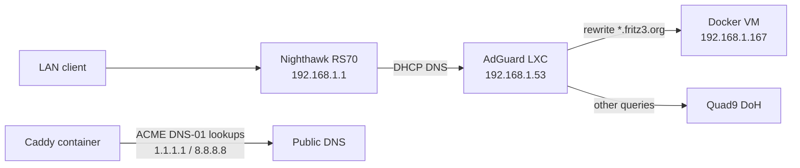

# Homelab services (Proxmox)

Docker Compose services for Ethan’s Proxmox-era home lab. Runtime path on the Docker VM: `/home/ethan/my_homelab_services/<service>`.

## Host and guests

| Role | Name | Address / ID | Notes |
|------|------|--------------|--------|
| Proxmox host | `pve` | 192.168.1.165 | Proxmox VE 9; Ryzen 7 5700G, 16 GB RAM; Tailscale subnet router for `192.168.1.0/24` |
| Docker VM | `docker` | VM 100 · 192.168.1.167 | Debian 13; Docker Engine + Compose |
| Home Assistant | `home-assistant` | VM 101 | HAOS 16.3 (imported from VDI); 2 cores, 2 GB; OVMF/q35 |
| AdGuard | `adguard` | LXC 102 · 192.168.1.53 | AdGuard Home; LAN DNS |

Retired: Raspberry Pi 3 (Pi-hole + PiVPN), DuckDNS.

## Services

| Public hostname | Upstream | Service |
|-----------------|----------|---------|
| `photo.fritz3.org` | `192.168.1.167:2283` | Immich |
| `music.fritz3.org` | `192.168.1.167:4533` | Navidrome |
| `navihelper.fritz3.org` | `192.168.1.167:3000` | navidrome-helper (separate repo) |
| — | host network on Docker VM | MediaMTX |

Caddy (Cloudflare DNS-01 TLS) terminates HTTPS for the `*.fritz3.org` sites above.

## DNS flow

LAN clients get AdGuard (`.53`) as their only DNS from the router. AdGuard rewrites `*.fritz3.org` to the Docker VM. Caddy uses public resolvers so ACME DNS-01 checks are not poisoned by that rewrite. Details: [docs/network.md](docs/network.md).

## Deploy a service

On the Docker VM (`192.168.1.167`):

1. Clone or pull this repo under `/home/ethan/my_homelab_services`.
2. In the service directory, copy `.env.example` to `.env` (if present) and fill in values. Never commit `.env`.
3. Run `docker compose up -d` in `/home/ethan/my_homelab_services/<svc>`.
4. Bring Caddy up last so TLS and reverse proxies are ready after backends.

## Docs

- [proxmox/README.md](proxmox/README.md) — host, VMs/LXC, Tailscale, planned Grok Bot access, backups
- [adguard/README.md](adguard/README.md) — AdGuard summary
- [docs/network.md](docs/network.md) — IPs, DHCP/DNS, rewrite, Caddy resolvers
- [docs/tailscale.md](docs/tailscale.md) — subnet router vs old PiVPN/DuckDNS; planned Grok Bot ACL
- [docs/restore.md](docs/restore.md) — Proxmox-era rebuild outline
- [docs/home-assistant.md](docs/home-assistant.md) — HAOS VM notes
- [cameras/README.md](cameras/README.md) — camera publish → MediaMTX
- [mediamtx/README.md](mediamtx/README.md) — MediaMTX on the Docker VM (paths, ports, status)
